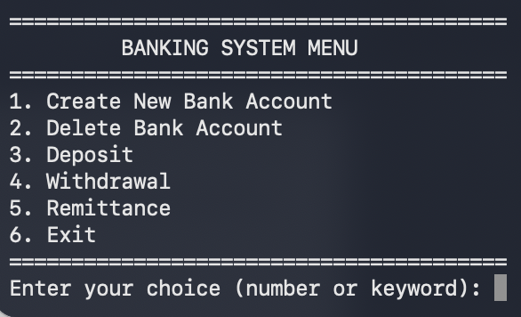
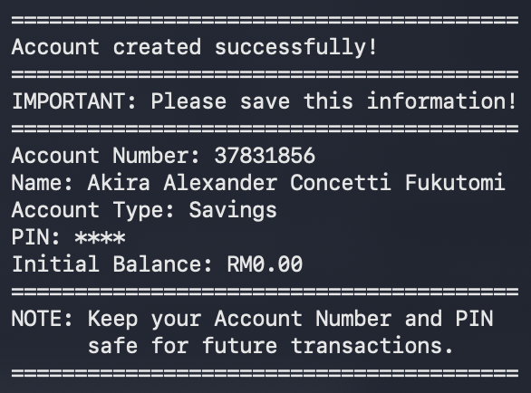

# Banking System

A command-line banking application built as a programming coursework project. It provides a menu-driven interface for creating and managing bank accounts and performing basic banking transactions.

The application runs in a terminal and stores account information in a local `database/` directory.

## Application Preview

<table>
  <tr>
    <th align="center">Main Banking Menu</th>
    <th align="center">Account Creation Confirmation</th>
  </tr>
  <tr>
    <td align="center"></td>
    <td align="center"></td>
  </tr>
  <tr>
    <td align="center">Navigate between account management and banking transactions.</td>
    <td align="center">Review the generated account number, account type, and starting balance.</td>
  </tr>
</table>

## Features

| Menu option | Function |
|---|---|
| **1 — Create New Bank Account** | Create a bank account and receive an account number. |
| **2 — Delete Bank Account** | Remove an existing bank account. |
| **3 — Deposit** | Add funds to a bank account. |
| **4 — Withdrawal** | Withdraw funds from a bank account. |
| **5 — Remittance** | Transfer funds using the remittance feature. |
| **6 — Exit** | Close the program. |

Account creation displays an account type, a masked PIN, and an initial balance. The program prompts users to keep the account number and PIN safe for subsequent transactions.

## Getting Started

### Requirements

- A terminal (macOS, Linux, or another supported environment)
- `make` and a compatible compiler to build the program from source

On macOS, if the developer command-line tools are missing, install them with:

```bash
xcode-select --install
```

### 1. Clone the Repository

```bash
git clone <repository-url>
cd Banking-System
```

Replace `<repository-url>` with your repository's GitHub HTTPS URL. If your local folder has a different name, use that name in the `cd` command.

### 2. Compile the Application

From the **project root** (the folder containing `Makefile`):

```bash
make
```

A successful build should produce the executable defined by the Makefile. The project's documented executable name is `banking_system`.

### 3. Run the Application

```bash
./banking_system
```

**Important:** Run the executable **from the project root**, not by double-clicking it in Finder. The application uses a relative `database/` path; starting it from another working directory can create or access the database in the wrong location.

### 4. Use the Menu

When prompted with `Enter your choice (number or keyword):`, enter a menu number (1–6) or a supported keyword and follow the on-screen instructions.

For example, select **1** to create an account, keep the generated account number and PIN, then return to the menu to try deposits, withdrawals, or remittances.

## Project Structure

```text
Banking-System/
├── include/          # Header files
├── srs/              # Project source directory (as named in repository)
├── Makefile          # Build and reset commands
├── README.md         # Project documentation
├── Media/            # README screenshots
│   ├── banking-menu.png
│   └── account-created.png
├── banking_system     # Executable (after compilation)
└── database/          # Runtime account storage (created as needed)
```

The executable and `database/` directory may not exist until after you build and run the program.

## Data Storage and Reset

Account data is stored locally in a `database/` folder relative to the working directory. To reset the saved accounts, **exit the banking application first** and run the project's reset target from the project root:

```bash
make reset
```

Alternatively, the original instructions describe manually deleting the runtime database directory:

```bash
rm -rf database
```

**Warning:** Resetting removes the saved account data. This is destructive and cannot be undone unless you have a backup.
